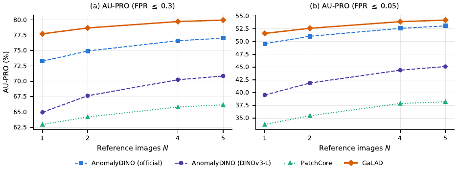
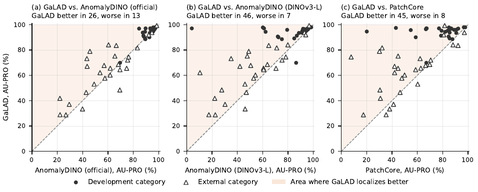
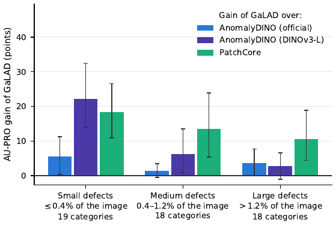
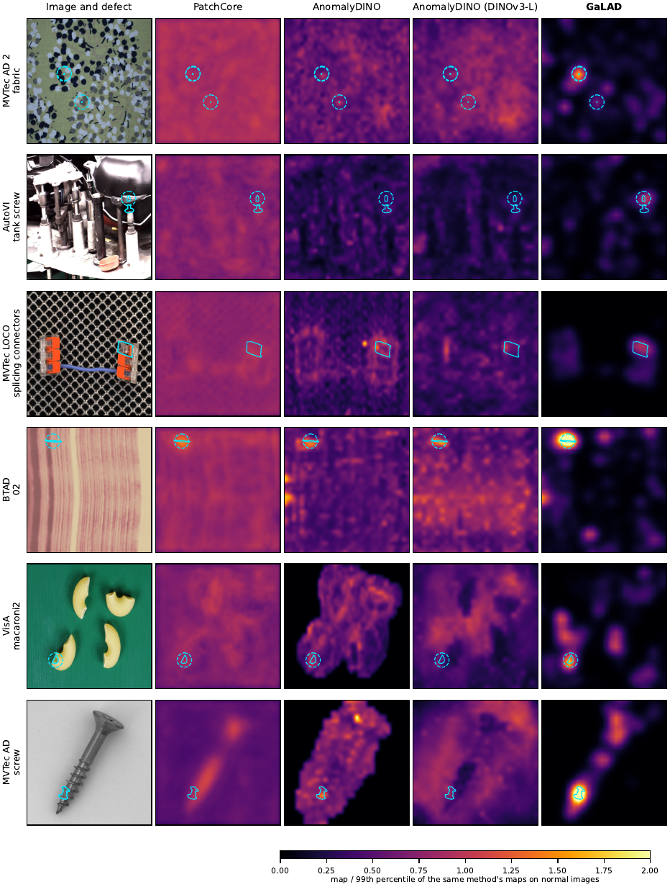

# GaLAD: Compact Gaussian Mixtures for Few-Shot Industrial Anomaly Detection and Localization

Code and results of the paper

> S. Villanueva López, E. Soria-Olivas, M. Sánchez-Montañés. *GaLAD: Compact Gaussian Mixtures for Few-Shot Industrial Anomaly Detection and Localization.* Submitted to *Electronics* (MDPI), 2026.

GaLAD sets up anomaly detection for a new product from one to five images of good parts and shows where the
defect is. A frozen DINOv3 ViT-L/16 backbone provides the patch features of two hidden layers; each reference
image is also rotated in steps of 45 degrees. For each layer, the features are projected with PCA to their 256
leading components and modeled by a Gaussian mixture with 12 components, fitted by EM (at most 30 iterations),
whose covariances are shrunk toward the covariance of all reference patches:

    Sigma_k = (n_k C_k + kappa Lambda) / (n_k + kappa),   kappa = 2000

Each test patch is scored by the chi-square tail of its Mahalanobis distance to the nearest component,
`-log P(chi2_256 >= min_k delta_k^2)`; the score map is smoothed (sigma = 1 patch), and the image score is its
95th percentile, averaged over the two layers. Fitting uses PCA and EM, without gradient-based training; the
model occupies 5.0 MiB per product whatever the number of reference images.

## Results

55 categories from seven benchmarks (MVTec AD, VisA, AutoVI, BTAD, GoodsAD, MVTec LOCO and the public test
set of MVTec AD 2), N = 1, 2, 4, 5 reference images, 5 draws, the same reference images for every method.

| Method | AU-PRO (FPR <= 0.3) | Image AP |
|---|---|---|
| PatchCore (WideResNet-50, Anomalib) | 64.8 | 78.1 |
| AnomalyDINO (DINOv3-L) | 68.4 | 80.6 |
| AnomalyDINO (official: DINOv2-S, background masks) | 75.4 | 81.9 |
| **GaLAD (DINOv3-L)** | **79.0** | 81.5 |

Paired AU-PRO differences, GaLAD minus each detector (95% bootstrap CI over categories): +10.6
[+6.5, +15.4] against AnomalyDINO on the same backbone (higher in
46 of the 55 categories), +3.6 [+1.3, +6.1] against the
official pipeline and +14.2 [+9.6, +19.1] against PatchCore.
The gains are largest on the smallest defects.









## Repository

| Path | Content |
|---|---|
| `galad/` | Reference implementation: data loading (`data.py`), DINOv3 features and rotations (`features.py`), GaLAD (`model.py`), AnomalyDINO scoring on the same backbone (`anomalydino.py`), metrics including the standard AU-PRO (`metrics.py`) |
| `scripts/run_eval.py` | Runs GaLAD and AnomalyDINO (DINOv3-L) on any set of categories, N and draws |
| `results/paper/` | Per-run results reported in the paper (see below) |
| `research/` | The research scripts that produced the paper results, as they were run (`server_eval.py` for GaLAD, 1-NN and AnomalyDINO; `adino_official.py`; `patchcore_eval.py`; `gauss_screen.py` and `ablation_aupro.py` for the ablation; `make_paper_*.py` for tables and figures) |
| `docs/` | Figures |

### Result files (`results/paper/`)

| Paper | File |
|---|---|
| Tables 2-5, A1-A4; Figures 2-4 (GaLAD and 1-NN on GaLAD features, every category, N and draw) | `galad_and_1nn.csv` |
| AnomalyDINO on DINOv3-L | `anomalydino_dinov3l.csv` |
| AnomalyDINO with its official configuration | `anomalydino_official.csv` |
| PatchCore (Anomalib 2.2 defaults, 448 px) | `patchcore.csv` |
| Table 6 (ablation on the development categories) | `ablation_ap.csv`, `ablation_aupro.csv`, `ablation_mahalanobis.csv` |
| Table 7 and Section 5.5 (cost; backbone in batches) | `cost.csv`, `cost_backbone.csv` |
| Defect size (Figure 4, Appendix D) | `defect_area.csv`, `defect_regions.csv`, `interior_aupro.csv` |
| MVTec AD 2 lighting conditions (Discussion) | `mvtec_ad_2_lighting.csv` |
| Eight and sixteen reference images; DINOv2 ViT-L/14 with registers (Appendix D) | `n8_n16.csv`, `dinov2l_registers.csv` |
| Every number quoted in the text | `paper_numbers.md` |

Metrics are stored as fractions; the paper reports percentages. Pixel AUROC and pixel AP are in the `pix_*` columns.

## Setup

Python 3.11 or later, PyTorch 2.7, transformers 4.57 or later (DINOv3). A CUDA GPU is recommended.

```bash
pip install -e .            # or: uv sync
```

The DINOv3 weights are gated on Hugging Face: accept the license of
`facebook/dinov3-vitl16-pretrain-lvd1689m` and log in (`hf auth login`) before the first run.

### Datasets

Download the datasets from their original sources and place them under `data/`:

```
data/
  mvtec_AD/        https://www.mvtec.com/company/research/datasets/mvtec-ad
  VisA/            https://github.com/amazon-science/spot-diff   (with split_csv/1cls.csv)
  mvtec_loco_AD/   https://www.mvtec.com/company/research/datasets/mvtec-loco
  AutoVI/          https://zenodo.org/records/10459003
  btad/            https://github.com/pankajmishra000/VT-ADL      (converted to the MVTec AD layout)
  GoodsAD/         https://github.com/jianzhang96/GoodsAD
  mvtec_ad_2/      https://www.mvtec.com/company/research/datasets/mvtec-ad-2   (public test set, MVTec AD layout)
```

## Usage

```bash
python scripts/run_eval.py --datasets VisA/pcb1 --ns 1 2 --seeds 0
python scripts/run_eval.py --all                       # the 55 categories of the paper
```

Results are written to `results/reproduced/final_square.csv` with the same columns as
`results/paper/galad_and_1nn.csv`.

To use GaLAD on your own images:

```python
from PIL import Image
from galad import GaLAD
from galad.features import Backbone

net = Backbone("dinov3l")
refs, _ = net.references(["good_1.png", "good_2.png"])          # rotated reference views
model = GaLAD(net.layers).fit(refs)
test = net.extract([net.prep(Image.open("part.png").convert("RGB"))])
scores, maps = model.score(test)                                # image score and 448x448 anomaly map
```

The operating threshold has to be chosen for each product on normal images of that product.

## Citation

```bibtex
@article{villanueva2026galad,
  title   = {{GaLAD}: Compact Gaussian Mixtures for Few-Shot Industrial Anomaly Detection and Localization},
  author  = {Villanueva L{\'o}pez, Sergio and Soria-Olivas, Emilio and S{\'a}nchez-Monta{\~n}{\'e}s, Manuel},
  journal = {Electronics},
  year    = {2026},
  note    = {Submitted}
}
```

## License

MIT (see `LICENSE`). The datasets keep their own licenses.
